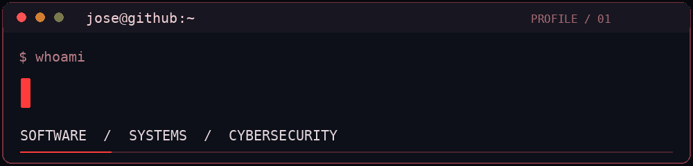

  

  **Estudiante de Ingeniería de Sistemas · Software Development · Cybersecurity**

  `PYTHON` · `RUST` · `C++` · `C#` · `TYPESCRIPT`

---

### `> whoami`

Soy estudiante de **Ingeniería de Sistemas en UTP**. Construyo proyectos para aprender sobre **software, herramientas de Windows y ciberseguridad**. Me interesa desarrollar soluciones útiles, abiertas y bien documentadas.

### `> ls featured-projects/`

| Proyecto | ¿Qué hace? | Tecnologías |
| :-- | :-- | :-- |
| 🛡️ [**Threat Intel Aggregator**](https://github.com/jose-seminario/threat-intel-aggregator) | Proyecto de análisis de indicadores de compromiso (IOC). | `Python` |
| 🎧 [**DashCompetitivoAudio**](https://github.com/jose-seminario/DashCompetitivoAudio) | Herramienta de procesamiento y personalización de audio competitivo. | `C++` |
| ⚡ [**InputDash**](https://github.com/jose-seminario/InputDash) | Diagnóstico y optimización de latencia en Windows. | `Rust` `TypeScript` |
| 🖥️ [**DashTweaks**](https://github.com/jose-seminario/DashTweaks) | Herramienta open-source de ajustes y configuración de Windows. | `C#` |

<b>📂 Otros proyectos</b>

- [cybersecurity-labs](https://github.com/jose-seminario/cybersecurity-labs) — laboratorios autorizados y write-ups.
- [Dashcord](https://github.com/jose-seminario/Dashcord) — proyecto de escritorio en Rust.
- [DashEyes](https://github.com/jose-seminario/DashEyes) — experimentos de visión y automatización en Python.
- [python-multithreaded-port-scanner](https://github.com/jose-seminario/python-multithreaded-port-scanner) — práctica de redes y concurrencia.
- [exchange-rate-calculator](https://github.com/jose-seminario/exchange-rate-calculator) — conversor de divisas por terminal.

### `> cat currently-learning.txt`

`FastAPI` · `REST APIs` · `Docker` · `Systems Programming` · `Web Security`

**Enfoque:** aprender construyendo, probar lo que funciona y documentar el proceso. Las prácticas de ciberseguridad son en **entornos autorizados**.

### `> ./connect.sh`

[**GitHub**](https://github.com/jose-seminario?tab=repositories) · [**LinkedIn**](https://www.linkedin.com/in/jaime-chuquipoma-seminario-b050b6b1/)

---

<code>BUILD  •  TEST  •  LEARN  •  REPEAT</code>

